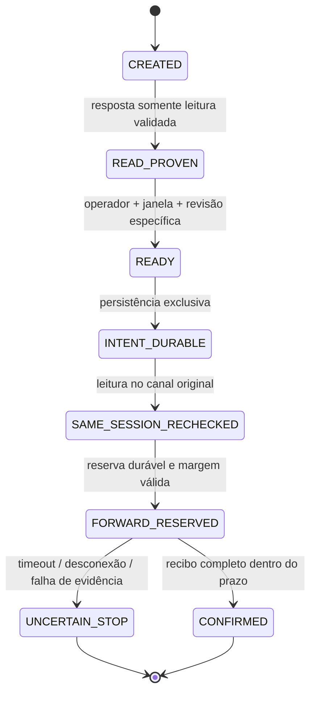

# C2 — desenho futuro de prontidão e modelo local

Status: **DRAFT_REVIEW_ONLY — execução real bloqueada**. Investigação histórica encerrada
com as [conclusões e limitações publicadas](./QA_C2_TIMEOUT_FORENSICS_20261103.md): timer local
de 120s comprovado, causa da espera indeterminada. Não repetir testes históricos ou
reconciliação sem fato novo. Este documento não reabre essa investigação.

O seed histórico continua consumido/resultado incerto. Marcador, orçamento e artefatos
históricos ficam intactos. Nenhuma autorização de perda. Nenhuma conexão TEST, seed,
perda, migração, fixture ou leitura do banco nesta tarefa. Cobertura permanece 16/60.

## Estados e evidências, sem equivalências implícitas

| Evento futuro | O que comprova | O que continua sem comprovação |
| --- | --- | --- |
| PROCESS_STARTED / PASSWORD_PROMPT_OBSERVED | Processo/prompt observados pelo cliente | Autenticação, senha recebida, TLS, backend e envio |
| READONLY_PROOF_VALIDATED | Resposta SQL somente leitura do canal autenticado; identidade e TLS conferidos com os critérios abaixo | Prontidão humana, autorização mutante e envio |
| OPERATOR_DECLARED_READY | Declaração explícita recebida e vinculada ao manifesto/prova/janela | Foco contínuo, capacidade futura de intervenção, autorização fora desse escopo |
| INTENT_DURABLE | Intenção exclusiva persistida/fsync antes de disponibilizar encaminhamento | Tentativa de entrega ou COMMIT |
| SAME_SESSION_RECHECKED | Nova resposta de leitura no mesmo canal com PID/backend_start/identidade iguais | Resultado de operação futura |
| FORWARD_RESERVED / PERMIT_PUBLISHED | Orçamento reservado; processo pode atingir a fronteira mutante | Recebimento de bytes pelo servidor, execução ou COMMIT |
| MUTANT_BOUNDARY_ENTERED | Processo reportou entrada na fronteira do driver | Não é prova de PQexec nem de entrega TCP/SQL |
| SQL_COMMAND_ACKNOWLEDGED | Resposta de comando esperada do backend, no protocolo revisado | COMMIT de toda a transação, se ainda não confirmado |
| COMMIT_CONFIRMED | Tag COMMIT válida, recibo posterior esperado, pós-condições/identidade e conclusão íntegra dentro do prazo | Assinatura criptográfica ou proteção contra administrador local |
| UNCERTAIN_STOP | Cliente perdeu certeza após a reserva/exposição | Rollback; permissão de reenviar; certeza de ausência de SQL |

Os nomes com SIMULATED no protótipo comprovam **somente a simulação**. Uma resposta fabricada
pelo LocalSession não autentica PostgreSQL nem verifica certificado. Um hash semântico da
prova identifica seus campos; os hashes SHA-256 dos arquivos identificam bytes. Nenhum é
assinatura ou autorização do usuário.

Falhas anteriores à reserva também encerram a instância, sem reabrir admissão. O modelo
não oferece resume. No transporte futuro, qualquer dúvida sobre publicação do permit já
consome conservadoramente a tentativa e exige parada, mesmo sem evento posterior de envio.

## Conexão e afinidade: mecanismo proposto para revisão

Uma execução futura teria **um único psql nativo** em conexão direta ao host TEST revisado
db.msinksoilkluooxenecy.supabase.co:5432, sem pool, conector entre fases, reconexão,
segundo psql ou backslash connect. A senha continuaria exclusivamente no prompt nativo,
sem variável de senha, captura de stdin ou histórico. Não há comando real fornecido aqui.

1. Antes de abrir o processo, o operador deve estar disponível; código, binários, CA,
   templates e política da tentativa anterior precisam de revisão própria. O manifesto fixa
   hashes, operação, identidade esperada e teto temporal. Nenhuma autoridade mutante é
   inserida no ambiente inicial e nenhum permit/arquivo executável mutante é publicado.
2. O psql executa somente o bootstrap de leitura, com script por arquivo, ON_ERROR_STOP,
   TLS verify-full/CA fixada e sem fallback. Uma transação READ ONLY obtém identidade SQL:
   pg_backend_pid, backend_start da própria sessão, database, SQL/session role e estado
   read_only; pg_stat_ssl para esse PID confirma SSL, versão e cipher. Valida-se a identidade
   esperada, elegibilidade e contratos de leitura definidos para aquela revisão futura.
3. Identidade do projeto resulta da conexão direta ao hostname TEST com verificação de
   certificado/hostname e configuração cliente revisada, mais as leituras esperadas. Texto
   TEST impresso por echo, database postgres ou um project_ref esperado devolvido como
   literal não identificam o projeto por si sós. Login PostgreSQL não equivale a login UI
   OWNER; a prova deve nomear claramente o principal autenticado.
4. Encerrar a transação READ ONLY antes da espera humana, mantendo a **mesma conexão**.
   Não manter locks/transação aberta nem alterar timeouts do servidor para sustentar espera.
   Um helper local fixado por hash é chamado sincronamente pelo psql para o gate do operador;
   ele não abre conexão de banco. Enquanto o helper lê a confirmação pública, psql aguarda
   o helper e não compete pela entrada. Senha já foi consumida pelo psql na fase anterior.
5. O operador confirma prontidão e a janela exclusiva UTC do manifesto após ver a prova.
   O gate exige revisão/autorização específica que reconheça a tentativa consumida. A
   declaração vincula prova, hashes, operação, escopo e ambos os limites da janela. Este
   gate continua **bloqueado pela situação histórica real**; o protótipo não decide como
   uma autorização futura poderia tratar esse bloqueio.
6. O helper persiste a intenção exclusiva e fecha/fsync antes de retornar sucesso. O
   bootstrap verifica explicitamente SHELL_ERROR e SHELL_EXIT_CODE do helper; erro, ausência
   de artefato ou estado incompatível encerram o processo. Nenhum arquivo mutante foi
   disponibilizado nessa etapa. Metadados locais de falha permanecem preservados.
7. O mesmo psql executa nova transação somente leitura e compara **canal/processo,
   PID + backend_start, identidade SQL, peer/TLS e vínculo da prova**. Mesmo PID isolado
   não basta. O canal direto não é devolvido a pool; perda da conexão encerra o script, sem
   reconectar. Cada entrada no gate local volta a verificar prazo e margem.
8. Só após essa leitura, um segundo estágio do mesmo helper local valida os vínculos,
   reserva exclusivamente o orçamento e publica o permit/dispatch local. O template será
   imutável/revisado e conterá somente a operação/hash autorizados, sem SQL arbitrário do
   operador. Publicação ou reserva incerta encerra como UNCERTAIN_STOP. Nenhuma reemissão.
9. O mesmo psql verifica sucesso do helper e só então atinge o driver mutante. O driver
   futuro precisa repetir a identidade e o prazo imediatamente antes de DML, dentro da
   mesma transação, e emitir as evidências de confirmação descritas na tabela. Permit,
   bootstrap, helper e driver necessitam revisão de bytes/contratos; isto não é uma
   adaptação aprovada dos SQLs históricos. Nenhum arquivo aprovado foi alterado agora.

As primitivas psql de execução por arquivo, helper e status de shell estão na
[documentação PostgreSQL 17](https://www.postgresql.org/docs/17/app-psql.html).
verify-full valida cadeia e hostname conforme
[libpq SSL](https://www.postgresql.org/docs/17/libpq-ssl.html); a leitura de backend_start e
pg_stat_ssl está documentada em
[monitoramento PostgreSQL](https://www.postgresql.org/docs/17/monitoring-stats.html).
Esse desenho usa essas primitivas; a integração nativa ainda não foi implementada/ensaiada.

## Prazo, persistência e resultado incerto

O teto do modelo é o mesmo limite de 120.000ms, iniciado na criação, **antes da autenticação**.
Prova, confirmação humana ou gate não reiniciam esse relógio. A janela apenas encurta o
prazo: D = min(T0 + 120s, fim UTC confirmado). A margem mínima de admissão permanece
30s, exigida antes e após a intenção, após revalidar a sessão e na fronteira de encaminhamento.
Não é extensão de timer nem promessa de que uma senha digitada tarde ainda caberá no prazo.

Há limite monotônico correspondente e observação UTC; retrocesso de relógio encerra. O
watchdog cobre esperas assíncronas e fecha a instância ao expirar. O desenho nativo também
precisa abortar o helper e o processo original, sem declarar que kill cancela COMMIT/rollback.
Uma confirmação tardia não muda automaticamente o estado terminal. Pode ser evidência para
revisão humana, jamais motivo de retry. Reconciliação futura seria somente leitura, dirigida
à pergunta em aberto e separada deste fluxo; nenhuma reconciliação é executada aqui.

Intenção e reserva são arquivos exclusivos, preservados inclusive em erro parcial. Ordem:
intenção durável -> leitura de identidade -> reserva durável -> disponibilização de envio.
Falha de persistência final não gera PASS. O journal termina selado; processo reiniciado
encontrando qualquer journal anterior não retoma nem reenvia. ACL, proteção contra links,
publicação atômica do permit e durabilidade contra energia/disco do adaptador real continuam
requisitos de implementação/revisão; o modelo local não promete resolvê-los.

## Protótipo mínimo e testes novos

Arquivos separados em prototypes/c2-readiness. Somente builtins Node, armazenamento local
e LocalSession em memória. Não há SQL, host de banco, psql, libpq, HTTP, socket, credencial,
fixture ou importação do executor operacional. O comando abaixo executa somente testes novos:

    node --test --test-reporter=tap prototypes/c2-readiness/protocol.test.mjs

Demonstração fixa local, que escreve somente seu journal sintético em diretório novo com
prefixo c2-readiness-local e o retém:

    node prototypes/c2-readiness/demo.mjs

A demonstração usa SIMULATION_ONLY, sem autorização real. Seu contador sintético não altera
o orçamento C2. assertRealExecutionBlocked sempre rejeita execução real. Os arquivos locais
intent/forward-reservation não são marcadores operacionais nem substitutos do marcador seed.

Foram testados apenas os 17 comportamentos novos: separação de prova/prontidão; vínculos do
ack; ordem das fases; troca de backend; falha da intenção; prazo absoluto e janela; espera
assíncrona; resposta incerta; confirmação tardia/errada; replay/reinício; persistência final;
retrocesso de relógio; bloqueio real; margem de admissão e sua conferência após intenção;
reserva incerta conservadora. Nenhuma suíte aprovada foi refeita e F01–F05 não foram reabertos.
Uma CI própria executa exclusivamente esse arquivo, sem dependências ou segredos TEST.

Validação concluída: 17/17 local, 17/17 Linux e 17/17 Windows, zero falhas/skips. Código
b7efa3bcbaa531cbb1b0b548eacd751426fc228b, [CI 41674924845](https://github.com/lucasmasseliamerica-cyber/masseli-business-manager/actions/runs/41674924845).
Nenhum build ou suíte anterior repetido. A publicação desses resultados muda somente
documentação/evidência; os três arquivos do modelo mantêm os bytes do código validado.

Checkpoint: desenho/modelo para revisão, sem adaptação operacional pronta. Autenticação/TLS
reais, console nativo, publicação do permit e identidade SQL real ainda não são comprovados.
O próximo passo depende de revisão específica deste desenho e autorização que reconheça
a tentativa anterior. Não há pedido de execução, renovação genérica ou trabalho adicional
inventado neste checkpoint.
